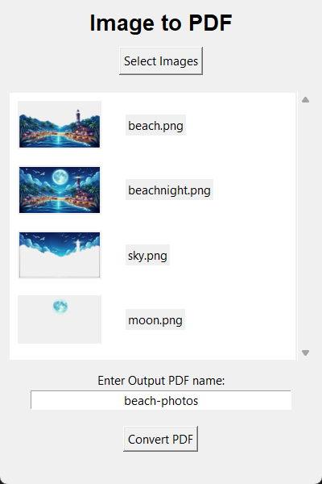

# Image to PDF

A small desktop app made with Python and Tkinter that turns a set of images into one PDF. Pick your images, check the previews, give the file a name and click convert.

## Screenshot



## Features

- Select multiple PNG or JPG images at once
- Scrollable list of thumbnails for the selected images
- One image per page, scaled to fit a Letter-size page and centered
- Conversion runs in a background thread, so the window doesn't freeze
- A "Processing..." overlay while it works and a message when it's done

## Getting started

You need Python 3.9 or newer. Tkinter comes with the standard Python installer on Windows and macOS. On Linux you may need to install it separately (for example `sudo apt install python3-tk`).

```bash
git clone https://github.com/balankdharan/python-image2pdf.git
cd python-image2pdf
python -m venv venv
source venv/bin/activate      # Windows: venv\Scripts\activate
pip install -r requirements.txt
python app.py
```

## How to use

1. Click **Select Images** and choose one or more images.
2. Type a name for the PDF (without `.pdf`). If you leave it empty, the file is called `output.pdf`.
3. Click **Convert PDF**. The PDF is saved in the folder you ran the app from.

## Built with

- Tkinter for the window
- Pillow for the thumbnails
- ReportLab for writing the PDF
